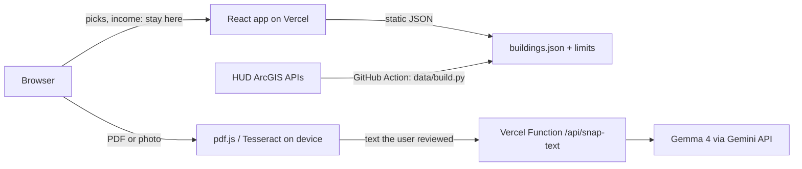

# HomePick DMV

Pick between two income-restricted buildings at a time. HomePick learns what matters to you, estimates what
you'd pay, and gives first-time renters in Washington, DC and Arlington, VA a short list with next steps.
Snap a form turns a rental application into a checklist with Gemma 4, quoting the form so you can check it.

Built for GDG Build with AI x Hacktoberfest 2026 (AI for Housing) at Virginia Tech.

## Run it

```bash
npm install
npm run dev          # http://localhost:5173 , uses sample data
npm test             # eligibility and ranking tests
npm run build
```

The AI routes (`/api/*`) run on Vercel. Locally, use `npx vercel dev` with `GEMINI_API_KEY` in `.env`
(copy `.env.example`). Without a key, Snap a form still works with the sample form (cached result) and
falls back to highlighted lines.

## AI model

- **Model:** Gemma 4, `gemma-4-26b-a4b-it` (fallback `gemma-4-31b-it`), called through the Gemini API from `api/snap-text.ts`.
- **License:** Apache 2.0 ([Gemma 4 announcement](https://opensource.googleblog.com/2026/03/gemma-4-expanding-the-gemmaverse-with-apache-20.html)).
- **What it does:** turns the text of a rental application into a checklist of documents, fees, deadlines, and contacts. Every item must quote the form word for word, or it is dropped.
- **What it never does:** decide eligibility or cost. That math is plain code with tests.

## Architecture



## Rubric map

| Criterion | Where to look |
|---|---|
| Problem and impact | Persona: young workers in DC and Arlington under the 60% limit ($69,780 for one person, 2026) |
| AI integration | Multimodal Snap a form: on-device OCR, Gemma 4 extraction, quote verification |
| Architecture | `src/lib` tested logic, `api/` small functions, static data |
| Safety and grounding | Quote check (server and browser), banned-phrase filter, no AI in eligibility math |
| Privacy | Income and files stay on the device; only reviewed text is sent; no logging |
| Inclusive design | Keyboard picker, screen reader labels and live region, focus styles, reduced motion, plain language |
| Deployment and cost | One free Vercel deploy, static data, small model, cached demo result, rate limit |
| Docs | This README, `RESOURCES.md`, `data/README.md` |

## How it works

| Part | Where | Notes |
|---|---|---|
| Picker and ranking | `src/lib/ranking.ts` | Pairwise model in the browser. Features: cost, income-based rent, bedrooms, Metro distance, size. No place features. |
| Cost and income limits | `src/lib/eligibility.ts` | Computed in code, never by AI. MTSP limits for tax-credit buildings, Section 8 for HUD-assisted. |
| Snap a form | `src/lib/snap.ts`, `api/snap-text.ts` | Text is read on the device (pdf.js, Tesseract). Only text you review is sent. Items whose quote is not in your text are dropped, on the server and again in the browser. |
| Data | `data/build.py`, `.github/workflows/data.yml` | Official HUD APIs to JSON: 331 buildings in DC and Arlington. A GitHub Action rebuilds and commits it. See `data/README.md`. |

## Privacy

Income, picks, and photos stay in your browser (session storage, cleared when the tab closes).
`GEMINI_API_KEY` is server-side only. The API does not log request content.

## Credits and data

- HUD LIHTC Database and HUD Multifamily Assisted Properties (public domain, U.S. government)
- 2026 income limits for the Washington-Arlington-Alexandria HUD Metro FMR Area (MTSP and Section 8)
- WMATA Metro station locations (Open Data DC)
- Gemma 4 via the Gemini API
- React, Vite, Tailwind CSS, pdf.js (Apache-2.0), Tesseract.js (Apache-2.0)

Estimates only. Each property decides who qualifies.

## License

MIT
