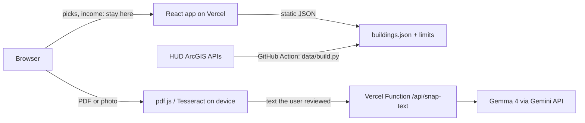

# HomePick DMV

**Live:** https://gdghacks-tau.vercel.app

Pick between two income-restricted buildings at a time. HomePick learns what matters to you, estimates what
you'd pay, and gives first-time renters across the DMV (DC, suburban Maryland, and Northern Virginia) a short list with next steps.
Snap a form turns a rental application into a checklist with Gemma 4, quoting the form so you can check it.

Built by **Three Man** (Prateek Malekar, Sajjad Irshad, Rishik Uppalapati) for GDG Build with AI x Hacktoberfest 2026 (AI for Housing) at Virginia Tech.

## Run it

```bash
npm install
npm run dev          # http://localhost:5173 , uses sample data
npm test             # eligibility and ranking tests
npm run build
```

The AI routes (`/api/*`) run on Vercel. Locally, use `npx vercel dev` with `GEMINI_API_KEY` in `.env`
(copy `.env.example`). Without a key, Snap a form still works with the sample form (cached result) and
falls back to highlighted lines.

Street View photos need `GOOGLE_MAPS_BROWSER_KEY` (or `VITE_GOOGLE_MAPS_KEY`): a browser key restricted in
Google Cloud to the site's address and to the Street View Static API. The page reads it from `/api/config` at
runtime, so adding it in Vercel needs no rebuild. It is public by design; the restrictions are what protect it,
so they must actually be set in Google Cloud Console:

1. **APIs & Services > Credentials**, open the key. Application restrictions: **Websites**, with
   `https://gdghacks-tau.vercel.app/*` as the only entry. API restrictions: **Restrict key**, with only
   **Street View Static API** ticked. Save, then allow about five minutes.
2. **APIs & Services > Street View Static API > Quotas**: set **Requests per day** to a cap such as 2,000.
3. **Billing > Budgets & alerts**: a budget of a few dollars with email alerts at 50%, 90%, and 100%.

The smoke workflow checks step 1 from outside: Google must answer `REQUEST_DENIED` with no referrer or another
site's referrer. A referrer can be faked by a script, so the daily quota in step 2 is the real ceiling on cost.
On the page, the landing reel loads street photos only while it is on screen, plays six frames on its own and
then waits for a tap, and loads at most 12 street photos per page view. `/api/health` says only whether Street
View is on, never anything about the key.

## AI model

- **Model:** Gemma 4, `gemma-4-26b-a4b-it` (fallback `gemma-4-31b-it`), called through the Gemini API from `api/snap-text.ts`.
- **License:** Apache 2.0 ([Gemma 4 announcement](https://opensource.googleblog.com/2026/03/gemma-4-expanding-the-gemmaverse-with-apache-20.html)).
- **What it does:** turns the text of a rental application into a checklist of documents, fees, deadlines, and contacts. Every item must quote the form word for word, or it is dropped.
- **What it never does:** decide eligibility or cost. That math is plain code with tests.
- **Where the text goes:** the text you review in the box is sent to Google's Gemini API. This deployment uses
  a Gemini API key on the **free (unpaid) tier**. Under Google's terms for unpaid services, Google may use
  prompts and responses to improve its products, and human reviewers may read them. That is why the app asks
  you to delete names, Social Security numbers, and account numbers before you continue, and why the file
  itself never leaves your device. On the paid tier Google states it does not use the data to improve its
  products; if this deployment moves to a billing-enabled project, this note will say so.
- **Scam warnings** are code, not AI: the text is scanned for gift cards, payment apps, wire transfers,
  crypto, "pay before you see it", and pressure tactics, and the checklist carries a warning at the top and on
  each affected item. The AI's own labels are checked too: every number, address, and most words in a label
  must come from your form, so a planted label cannot ride on an honest quote.

## Architecture



## Rubric map

| Criterion | Where to look |
|---|---|
| Problem and impact | Persona: young workers across the DMV under the 60% limit ($69,780 for one person, 2026) |
| AI integration | Multimodal Snap a form: on-device OCR, Gemma 4 extraction, quote verification |
| Architecture | `src/lib` tested logic, `api/` small functions, static data |
| Safety and grounding | Quote check and label check (server and browser), banned-phrase filter, scam-pattern warnings, no AI in eligibility math |
| Privacy | Income and files stay on the device; only reviewed text is sent; no logging |
| Inclusive design | Keyboard picker, screen reader labels and live region, focus styles, reduced motion, plain language |
| Deployment and cost | One free Vercel deploy, static data, small model, cached demo result, rate limit. A checklist is one Gemma call of roughly 1,500 input and 300 output tokens: free on the Gemini API free tier, and well under a cent at Flash-class paid rates |
| Docs | This README, `RESOURCES.md`, `data/README.md` |

## How it works

| Part | Where | Notes |
|---|---|---|
| Picker and ranking | `src/lib/ranking.ts` | Pairwise model in the browser. Features: cost, income-based rent, bedrooms, Metro distance, size. No place features. |
| Cost and income limits | `src/lib/eligibility.ts` | Computed in code, never by AI. MTSP limits for tax-credit buildings, Section 8 for HUD-assisted. |
| Income box | `src/lib/income.ts` | Required: the picker and results only show buildings the income appears to fit (under the estimated limit, or the "maybe" band for HUD-assisted buildings). If the chosen areas hold fewer than 16 fitting buildings, neighboring areas join the search (`widenAreas` in `src/lib/areas.ts`) and the picker says which. Typed per month or per year; the math is always yearly. The slider starts at a year of the cheapest capped rent in the data ($17,000 in 2026, a 50%-tier studio), and a "yearly" number under that, or a "monthly" one over $12,500, gets an offer to switch instead of a refusal, since income-based HUD homes take any income. |
| Screens | `src/App.tsx`, `src/components/` | Landing, basics, picker, results, Snap a form, How it works (`#how`), Our goal (`#about`). The step lives in the URL hash, so Back, Forward, refresh, and a pasted `/#about` all land on the right screen; picks and areas persist by id in this tab's session storage. |
| Motion | `src/index.css` | CSS only (the CSP allows no third-party scripts): masked line rises on headlines, a staggered hero entrance, scroll-driven dusk on the landing, view transitions between screens, a drifting tile mosaic of real doors on the goal page, and the results spotlight. `prefers-reduced-motion` turns all of it off; print turns it off too. |
| Performance | `src/index.css`, `src/components/DmvMap.tsx` | Lighthouse 95 mobile and 100 desktop in a headless run (performance; accessibility 100, SEO 100). Animations touch only transform, opacity and clip-path; the skyline's flickering windows are one animated group per house; the map's 1,704 building dots are two SVG paths; the ranking runs only on the screens that show it; web fonts load without blocking; on slow 3G the headline is on screen in under 4 s before the building data arrives. |
| Landing reel | `src/components/HeroReel.tsx` | Two buildings per area, chosen from those whose Street View photo is trusted by the index below, so every frame is a real street photo; areas without one show the aerial view. |
| Snap a form | `src/lib/snap.ts`, `api/snap-text.ts` | Text is read on the device (pdf.js, Tesseract). Only text you review is sent. Items whose quote is not in your text are dropped, on the server and again in the browser. |
| Data | `data/build.py`, `.github/workflows/data.yml` | Official HUD, USDA, DC, Maryland, and Alexandria APIs to JSON: 1,704 buildings holding about 122,000 income-restricted homes (1,444 buildings shown in the picker) across the 20 counties and cities of HUD's Washington metro income-limit area, grouped into the 12 areas you can pick in the app. Plus Census county outlines for the map and HUD Small Area Fair Market Rents by ZIP for the "typical rent nearby" comparison. A GitHub Action rebuilds and commits it. See `data/README.md`. |

## Privacy

Income, picks, and photos stay in your browser (session storage, cleared when the tab closes).
`GEMINI_API_KEY` is server-side only. The API does not log request content.
Building photos are Google Street View images (when a key is set) and aerial tiles from Esri World Imagery;
Google and Esri see which public building locations are viewed, never anything you type. The OCR engine and English language data are served from this site
(copied from `node_modules` at build time), so reading a form makes no request to any CDN. Fonts load from
Google Fonts. Security headers (CSP, frame-ancestors, nosniff, referrer policy) are set in `vercel.json`.

## Testing and accessibility

- `npm test`: 156 unit tests across 9 files: eligibility math, ranking, guardrails and banned phrases, the
  API rate limiter and request validation, text chunking, income parsing and saved-answer sanitizing, the
  price headline, area neighbors and search widening, and the plain-language errors the Snap request gives
  when the service is offline, rate limited, broken, or answers nonsense.
- `npm run check:ui` (also run in CI, `.github/workflows/ci.yml`): builds the site, then walks the start,
  basics, pick, and results screens in headless Chromium at 1280px and 390px, with and without reduced
  motion. It fails on any axe-core violation (WCAG 2.0/2.1/2.2 A and AA rules), a headline that does not
  read as separate words, a missing `h1`, focus that does not move to the new screen, two pick cards that are
  not side by side on a phone, or sideways scroll. It also prints the results to PDF under print media and
  fails if anything is still animating or faded, or the PDF is near empty.
- The smoke workflow runs the same walk against the live site (`UI_CHECK_URL=... node scripts/ui-check.cjs`).
  The site's Content-Security-Policy blocks injected scripts, and axe is one, so that run's test browser alone
  bypasses CSP (Playwright `bypassCSP`). The policy the site sends is unchanged.
- Last run before submission: **0 axe violations on all 4 screens**, both motion modes, both widths.
- Scripted edge-case passes before submission (Playwright, not in CI): every income entry form ("$52,000.00",
  "52k", "1.5K", "52,000/yr", "1,000,001", ".5", 83,334 a month), the monthly/yearly toggle and the
  "is that monthly?" nudge, household 8+, every toggle on at once, double taps on a pick, undo, arrow keys,
  finishing early, refresh and Back/Forward mid-flow, Start over, share to clipboard, editing answers to an
  income nothing fits, the spotlight's Escape/auto-close/Back-Forward, and the Snap flow with the API offline,
  rate limited, failing, or answering garbage. Five widths from 320px to 1440px plus reduced motion.
- Checked by hand: keyboard-only flow (tab, arrow keys in the picker, pause button on the hero slideshow),
  VoiceOver labels on the pick buttons, 200% zoom on a 1024px window.
- Not tested: real screen readers other than VoiceOver, Windows High Contrast mode, Safari on iOS before 16,
  text contrast on the animated gradient backgrounds beyond the fixed pairs below.
- Contrast: body text `#2a1a3a` and headline accent `#8e1247` were checked against the lightest and darkest
  stops of every background gradient (`#ffe3b0`, `#d7b8ff`, `#fff3ea`) and all pass 4.5:1. Gold `#ffc53d`
  and white are only used as text on the dark plum backgrounds (`#2a1f4d` and darker), at 9:1 or better.

## Known limitations

- **Phone numbers:** 1,271 of 1,704 buildings (75%) have no phone in their source list (DC's and Maryland's
  lists carry none). Those cards say so and link a web search for the leasing office instead.
- **Waitlists and vacancies:** no source has vacancies. Public housing cards show HUD's average months on the
  waitlist for recent move-ins when HUD reports it; every card says to call and ask.
- **Newer lists, fewer details:** rows from DC's, Maryland's, and Alexandria's lists have no bedroom sizes,
  and DC rows are labeled by their highest income tier ("up to 80% MFI") with the full tier mix on the card.
  Tiers of 30% and 80% use estimated limits (the 50% table scaled, as HUD does before its caps).
- **Same building on two lists:** rows are merged when they sit at the same spot with the same house number,
  or within about 60 m with a distinctive name word in common. Two phases of one site on the same list stay
  separate.
- **Rent figures are caps, not asking rents.** Tax-credit caps come from HUD's MTSP tables for the whole
  metro area at the building's tier; real rents are often lower. Income-based rent is estimated at 30% of
  the income you enter; the property uses adjusted income after deductions, so the real number differs.
- **Eligibility is estimated**, never decided. The app says "you appear to be under the limit" and the
  property decides. Student rules, minimum incomes, and credit checks vary by building.
- **Rate limiting is per serverless instance** (10 calls a minute and 100 a day per address, 200 an hour per
  instance; the sample form is served from cache and never counts). The hard ceiling is the Gemini API quota and budget alert in Google AI Studio.
- **OCR is English only** and reads up to 10 pages of a PDF (3 pages when the PDF is a scan). Photos are
  downscaled to 2200px before reading. HEIC photos open on Safari; other browsers ask for JPG or PNG.
- **Long forms** are sent in pieces of about 16 KB each, so a 40-page packet means several AI calls. If one
  piece fails, the checklist from the other pieces still shows, with a note saying which part is missing.
- **Scam detection is pattern matching.** It catches the common asks (gift cards, Zelle, wire, pay-before-viewing)
  and will miss a scam written around them. Real applications never take payment that way, so when in doubt call
  the building's number listed here, not the one on the form.
- **HUD-assisted buildings and income limits:** most admit under the very-low-income (50%) limit, some up to
  80%. Between the two the card says "may be over, ask" and the "hide buildings I'm over the limit for" toggle
  keeps them.
- **Ranking and programs:** income-based rent gets no head start in the ranking (choose "Rent based on my income"
  to favor it), and the top three never show three of one program when the other is available. HUD-assisted
  buildings often have long waitlists, and HUD publishes no waitlist data.
- **"What we learned about you"** lists only what you chose on the basics step and what your picks moved clearly
  (a weight rise of 0.9 or more; eight random picks move the biggest weight about 0.36 at the median and 0.9 at
  the 95th percentile). Mixed picks say so instead of inventing a preference.
- **Data cleanup:** rows at the same spot with the same street address are merged (one listing per building),
  unit counts that come swapped from HUD ("98 of 32") are put the right way round, a row whose address was the
  developer's office is merged into the building's own row, and group homes and sites with three or fewer homes
  are flagged and kept out of the picker (they fill by referral). The latest placed-in-service year in HUD's
  LIHTC database release is 2019; HUD-assisted rows carry no year.
- **Building names and contacts** are as HUD publishes them, tidied (capitalization, "Apts", SOME's
  properties). Some names are the legal project name, not the sign on the door.
- **No interior photos.** HUD has none and listing photos are copyrighted, so cards show a Google Street View
  photo (when a key is set), then aerial, neighborhood, and street-map views, with a link to look around in
  Google Maps. Where the photo looks is decided **per building** ahead of time (`public/data/streetview.json`,
  built by the "Street View index" workflow from Google's free metadata endpoint): it asks Google for the
  nearest outdoor photo both by **street address** and by **HUD's coordinates**. When both land within about
  100 m of each other, the address wins (it aims the camera at the door). When only one side has a photo, that
  side is used. When they disagree by more than 100 m, neither is trusted and the **aerial view leads**, because
  a review of the disagreeing pairs showed each side wrong about half the time (HUD points on a parcel centroid
  or across the street; addresses that geocode to a shopping center or a road). Buildings with no photo at all,
  or an address Google cannot place ("Lot 3 On Noble Way"), also lead with the aerial view. A photo can still
  show the street rather than the building for large complexes set back from the road.
- **No ranking on neighborhood, school, or demographic data**, on purpose (fair housing).

## Credits and data

- HUD LIHTC Database and HUD Multifamily Assisted Properties (public domain, U.S. government)
- 2026 income limits for the Washington-Arlington-Alexandria HUD Metro FMR Area (MTSP and Section 8)
- WMATA Metro station locations (Open Data DC)
- Aerial imagery: Esri World Imagery (Esri, Maxar, Earthstar Geographics)
- Street-level photos: Google Street View Static API (when a browser key is set), shown with Google's own attribution
- Gemma 4 via the Gemini API
- React, Vite, Tailwind CSS, pdf.js (Apache-2.0), Tesseract.js (Apache-2.0)

Estimates only. Each property decides who qualifies.

## License

MIT
